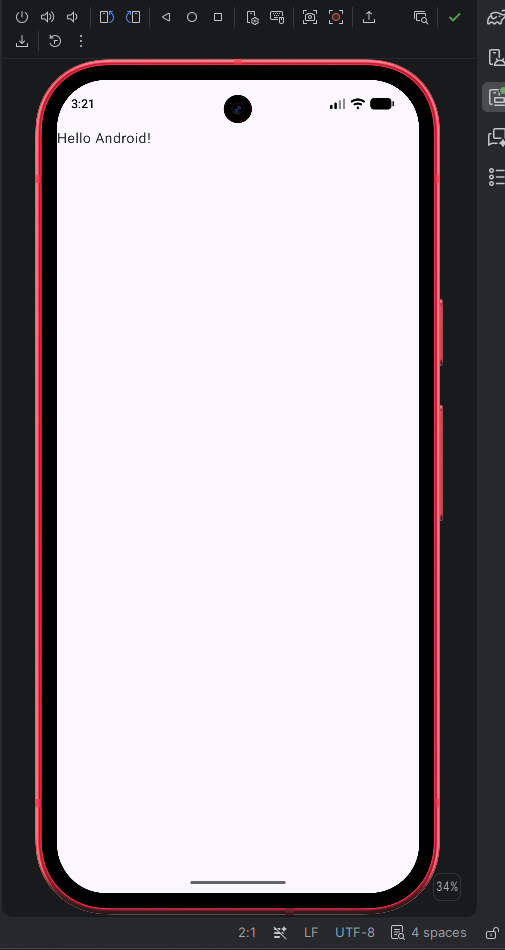
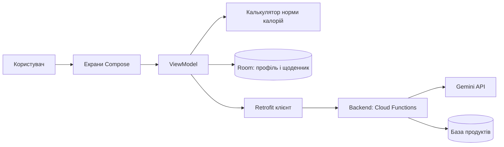
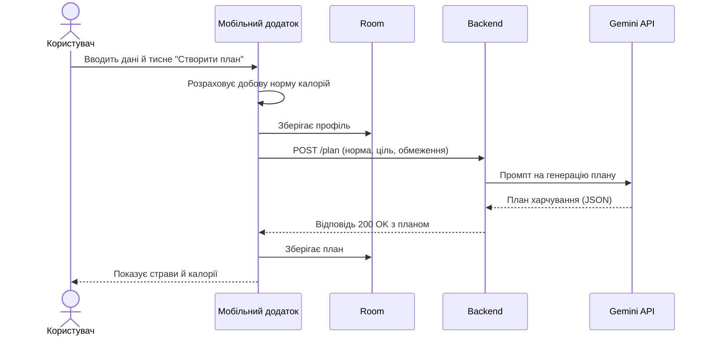
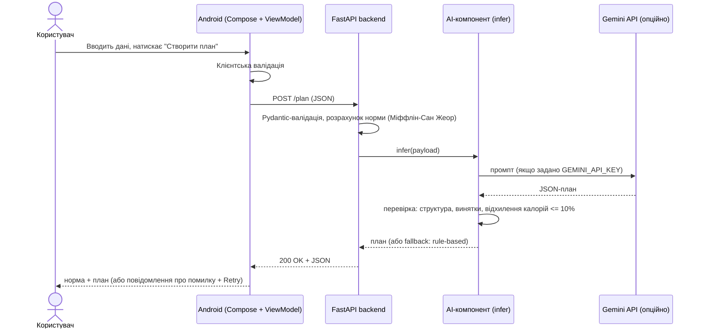

# Lab 1. Налаштування середовища та концепція мобільного додатку

**Студент:** Бабʼяк Анастасія
**Група:** ДС-44

## 1. Середовище розробки
Встановлено Android Studio, створено проєкт з шаблону Empty Activity, додаток запущено на емуляторі.



## 2. Індустрія
Дієтологія

## 3. Ідея додатку

**Назва:** Дієтокс, калькулятор калорій з AI-планом харчування.

- **Цільова аудиторія:** жінки та чоловіки віком 16-60 років.
- **Ключова проблема:** розрахунок калорій у харчуванні та складання раціону під свою норму.
- **Унікальна цінність:** розробка плану харчування відповідно до кількості калорій продуктів за допомогою підбору через ШІ.
- **Порівняння з аналогами:** FatSecret, Calorize, Calvi. У цих додатках розрахунок відбувається за фотозвітами: програма сама визначає калорійність продукту чи страви загалом, що зручно для щоденного використання. Деякі працюють із ШІ на базовому рівні: нагадування про прийом їжі, допомога з підбором продуктів для заповнення або зменшення калорій.
- **MVP-скоуп:**
  - **Входить у MVP:** введення даних користувача (вік, стать, вага, зріст, рівень активності, мета); розрахунок добової норми калорій; AI-генерація плану харчування на день; база продуктів із калорійністю та ручне додавання з'їденого; підрахунок калорій за день (з'їдено / залишилось).
  - **Не входить у MVP (відкладено на V1-V2):** розпізнавання їжі за фото; нагадування про прийом їжі; графіки прогресу та статистика за тиждень; синхронізація з фітнес-браслетами; соціальні функції та челенджі.


## 4. Архітектура

### Етапи розвитку
| Рівень | Що входить |
|---|---|
| **POC** | Форма введення даних, розрахунок добової норми калорій, один запит до AI з виведенням плану харчування текстом |
| **MVP** | Профіль користувача, AI-план харчування на день, база продуктів, щоденник з'їденого, лічильник «з'їдено / залишилось» |
| **V1** | Розпізнавання їжі за фото, нагадування про прийом їжі, графіки прогресу, план на тиждень |
| **V2** | Синхронізація з фітнес-браслетами, акаунти й хмарна синхронізація, соціальні функції, аналітика та моніторинг |

За межами курсу: V1 і V2.

### User stories для MVP
- Як користувач, я хочу ввести вік, стать, вагу, зріст і рівень активності, щоб отримати свою добову норму калорій.
- Як користувач, я хочу вибрати ціль (схуднути / утримати вагу / набрати), щоб норма відповідала моїй меті.
- Як користувач, я хочу отримати від AI план харчування на день, щоб не складати раціон самостійно.
- Як користувач, я хочу вказати продукти, які не їм (алергії, вподобання), щоб план мені підходив.
- Як користувач, я хочу додавати з'їдене в щоденник, щоб бачити, скільки калорій уже спожито.
- Як користувач, я хочу бачити, скільки калорій залишилось на день, щоб планувати наступні прийоми їжі.
- Як користувач, я хочу замінити страву в плані, щоб підібрати варіант до смаку.

### Компоненти системи
| Шар | Технологія | Обґрунтування |
|---|---|---|
| **Mobile** | Kotlin + Jetpack Compose | Сучасний стандарт Android, збігається з шаблоном проєкту |
| **Локальні дані** | Room (SQLite) | Профіль і щоденник працюють без інтернету |
| **Мережа** | Retrofit + JSON | Простий виклик backend |
| **Backend** | Firebase Cloud Functions (або FastAPI) | Мінімум коду для MVP, ключ AI не зберігається в додатку |
| **AI-шар** | Gemini API | Генерує план харчування за промптом із нормою калорій, ціллю та обмеженнями |
| **База продуктів** | Власний JSON-набір, далі відкрите API (наприклад Open Food Facts) | Для MVP достатньо невеликого локального списку |

### Діаграма компонентів

    
### Sequence-діаграма (головний сценарій: отримати план харчування)


### Потік даних
1. Користувач вводить дані в форму й тисне кнопку.
2. ViewModel перевіряє дані та розраховує норму калорій за формулою Міффліна-Сан Жеора.
3. Профіль зберігається в Room.
4. Додаток надсилає на backend HTTPS-запит POST у форматі JSON (норма, ціль, обмеження).
5. Backend формує промпт і викликає Gemini API.
6. Gemini повертає план у форматі JSON, backend перевіряє його структуру.
7. Додаток отримує відповідь, зберігає її в Room та показує на екрані.

## 5. Вимоги

### Функціональні вимоги
- FR1. Система повинна дозволяти ввести вік, стать, вагу, зріст, рівень активності та ціль.
- FR2. Система повинна розраховувати добову норму калорій за введеними даними.
- FR3. Система повинна генерувати за допомогою AI план харчування на день відповідно до норми калорій.
- FR4. Система повинна враховувати продукти-винятки (алергії, вподобання) при генерації плану.
- FR5. Система повинна показувати калорійність кожної страви й загальну суму за день.
- FR6. Система повинна дозволяти додавати продукти в щоденник вручну з бази продуктів.
- FR7. Система повинна показувати, скільки калорій з'їдено та скільки залишилось.
- FR8. Система повинна дозволяти замінити страву в плані (повторний запит до AI).
- FR9. Система повинна зберігати профіль, план і щоденник на пристрої.

### Нефункціональні вимоги
- **Продуктивність:** розрахунок норми за 1 с, генерація AI-плану не довше 10 с з індикатором завантаження.
- **Безпека:** ключ AI зберігається тільки на backend, зв'язок через HTTPS, особисті дані (вага, вік) не передаються третім особам.
- **Доступність:** достатній контраст тексту, підтримка збільшеного шрифту, зрозумілі підписи елементів.
- **Офлайн:** профіль, щоденник і збережений план доступні без інтернету; для нового плану інтернет потрібен.
- **Пристрої:** Android 8.0+ (API 26+), телефони різних розмірів екрана.
- **Безпека здоровʼя:** додаток не є медичним сервісом і показує відповідне застереження; для віку 16-17 років не пропонуються жорсткі обмеження калорій.

### Acceptance criteria (Given / When / Then)
**FR2. Розрахунок норми**
- Given користувач ввів коректні вік, вагу, зріст, стать і активність, When він натискає «Розрахувати», Then система показує добову норму калорій.
- Given у полі ваги вказано 0 або порожньо, When користувач натискає «Розрахувати», Then система показує повідомлення про помилку й не рахує.

**FR3. AI-план**
- Given норма калорій розрахована й є інтернет, When користувач натискає «Створити план», Then протягом 10 с з'являється план із прийомами їжі.
- Given сума калорій у плані відхиляється від норми більш ніж на 10%, When план отримано, Then система повторно запитує AI або попереджає користувача.
- Given інтернету немає, When користувач натискає «Створити план», Then система показує повідомлення про відсутність мережі й пропонує спробувати пізніше.

**FR6-FR7. Щоденник**
- Given відкритий щоденник, When користувач додає продукт із вагою, Then калорії додаються до «з'їдено» й зменшують «залишилось».
- Given спожито більше за норму, When калорії оновились, Then «залишилось» показує перевищення (наприклад, червоним кольором).

**FR8. Заміна страви**
- Given відкритий план, When користувач натискає «Замінити» біля страви, Then з'являється нова страва з близькою калорійністю.

### Пріоритезація (MoSCoW)
| Категорія | Вимоги |
|---|---|
| **Must have** | FR1, FR2, FR3, FR5, FR7, FR9, безпека ключа AI |
| **Should have** | FR4, FR6, FR8, обробка помилок мережі |
| **Could have** | Темна тема, підтримка кількох мов, експорт плану |
| **Won't have (у MVP)** | Розпізнавання за фото, нагадування, графіки, синхронізація з браслетами, соціальні функції |

### Edge cases
**Враховуємо в MVP:**
- некоректні або порожні дані (від'ємна вага, вік поза 16-60);
- відсутність інтернету або таймаут AI;
- AI повернув відповідь у неправильному форматі;
- сума калорій у плані сильно відрізняється від норми;
- користувач вказав так багато винятків, що план неможливо скласти;
- норма виходить за безпечні межі (дуже низька чи висока).

**Відкладаємо:**
- кілька користувачів на одному пристрої;
- зміна одиниць (фунти, дюйми);
- конфлікти синхронізації між пристроями;
- обробка рідкісних дієт (веганство, кето, медичні дієти).


## 6. Використання AI
Для генерації ідей, архітектури та вимог використано Gemini (gemini.google.com). Основні промпти: пошук унікальної цінності й порівняння з аналогами, визначення MVP-скоупу, генерація user stories, Mermaid-діаграм, функціональних і нефункціональних вимог, acceptance criteria та MoSCoW.

---

# Lab 2. Базова реалізація мобільного AI-застосунку «Дієтокс»

Працюючий MVP: **Android (Kotlin + Compose) → HTTP API → backend (Python + FastAPI) → AI-компонент → результат у UI**
зі станами `Idle / Loading / Success / Error`.

## 1. Сценарій (Task 1)

> **Як** користувач (16-60 років) **я хочу** ввести свої параметри (вік, стать, вага, зріст, активність, ціль, продукти-винятки)
> **щоб** отримати свою добову норму калорій і AI-план харчування на день.

**Чому саме він.** Це «зерно» продукту з Lab 1 (FR1-FR3 з MVP): без нього застосунок не має сенсу, а решта фіч (фото, графіки,
нагадування) від нього залежать. Сценарій починається дією користувача (форма) і завершується корисним результатом
(норма + 4 прийоми їжі з калоріями). Він покриває всі шари: UI → мережа → backend з валідацією → AI → UI.

## 2. Архітектура та дані (Task 2)



**Вхідні дані `POST /plan`**

| Поле | Тип | Обов'язкове | Обмеження |
|---|---|---|---|
| `age` | int | так | 16-60 |
| `sex` | string | так | `male` / `female` |
| `weight_kg` | number | так | 30-250 |
| `height_cm` | number | так | 120-230 |
| `activity` | string | так | `sedentary` / `light` / `moderate` / `high` |
| `goal` | string | так | `lose` / `maintain` / `gain` |
| `excluded` | string[] | ні | до 10 елементів, до 40 символів кожен |

**Успішна відповідь (200):** `calories {bmr, tdee, target}`, `meals[] {name, items[] {name, grams, kcal}, kcal}`,
`total_kcal`, `deviation_pct`, `source` (`gemini` | `rule-based`), `warnings[]`, `disclaimer`.

**Помилки** (єдиний формат `{"error": {"code": "...", "message": "..."}}`, без stack trace):

| Де | Ситуація | Код / поведінка |
|---|---|---|
| Mobile | порожні/некоректні поля | запит не надсилається, повідомлення під полем |
| Mobile | backend недоступний / таймаут | стан Error + кнопка «Спробувати ще раз» |
| Mobile | JSON неповний або зламаний | стан Error («некоректна відповідь»), без краху |
| Backend | невалідні дані | `422 VALIDATION_ERROR` |
| Backend | неможливо скласти план з такими винятками | `422 PLAN_IMPOSSIBLE` |
| Backend | внутрішня помилка | `500 INTERNAL_ERROR` |
| AI | Gemini недоступний / невалідна відповідь | контрольований fallback на rule-based + `warnings` |

## 3. Структура репозиторію

```
Lab1/
├── app/                      # Android-застосунок
│   └── src/main/java/com/example/lab1/
│       ├── MainActivity.kt
│       ├── data/             # ApiConfig, ApiModels (DTO), DietoxApi (Retrofit), PlanRepository
│       └── ui/               # PlanViewModel (UiState), PlanScreen (Compose + Preview)
│   └── src/test/.../PlanViewModelTest.kt
├── backend/                  # FastAPI
│   ├── app/                  # main.py, schemas.py, calc.py, foods.py, planner.py, ai.py
│   ├── tests/test_core.py
│   ├── tools/ai_validation.py
│   ├── examples/*.json       # приклади запитів/відповідей
│   ├── requirements.txt
│   └── .env.example
└── screenshots/
```

## 4. Запуск backend

Потрібен Python 3.11+. З кореня репозиторію (Windows, PowerShell):

```powershell
cd backend
python -m venv .venv
.venv\Scripts\Activate.ps1
pip install -r requirements.txt
copy .env.example .env
uvicorn app.main:app --reload --host 0.0.0.0 --port 8000
```

Перевірка: `http://localhost:8000/health` → `{"status":"ok"}`, Swagger UI: `http://localhost:8000/docs`.

**AI-режими.** Без ключа працює базовий алгоритм (`source: "rule-based"`). Щоб увімкнути Gemini, впишіть ключ у `backend/.env`
(`GEMINI_API_KEY=...`, ключ з aistudio.google.com). Файл `.env` у `.gitignore` -- ключ у репозиторій не потрапляє.

## 5. Запуск mobile

1. Відкрийте проєкт у Android Studio. У `app/build.gradle.kts` у блок `dependencies { }` додайте:
   ```kotlin
   implementation("com.squareup.retrofit2:retrofit:2.11.0")
   implementation("com.squareup.retrofit2:converter-gson:2.11.0")
   implementation("com.squareup.okhttp3:okhttp:4.12.0")
   implementation("androidx.lifecycle:lifecycle-viewmodel-compose:2.8.7")
   testImplementation("org.jetbrains.kotlinx:kotlinx-coroutines-test:1.8.1")
   ```
2. У `app/src/main/AndroidManifest.xml`: перед `<application>` додайте
   `<uses-permission android:name="android.permission.INTERNET" />` та
   `<uses-permission android:name="android.permission.ACCESS_LOCAL_NETWORK" />`,
   а в тег `<application ...>` -- атрибут `android:usesCleartextTraffic="true"` (локальний HTTP без TLS, тільки для розробки).
   `ACCESS_LOCAL_NETWORK` потрібен на Android 17 (API 37): без нього підключення до backend у локальній мережі
   (`10.0.2.2`) завершується `SocketTimeoutException`. Якщо запит усе одно не проходить, видайте дозвіл
   у налаштуваннях застосунку (App info → Permissions).
3. **Адреса backend** -- файл `data/ApiConfig.kt`:
  - емулятор: `http://10.0.2.2:8000/` (значення за замовчуванням; `10.0.2.2` = localhost комп'ютера);
  - фізичний телефон: `http://<IP комп'ютера в Wi-Fi>:8000/` (дізнатися: `ipconfig`), телефон і ПК -- в одній мережі;
    у Windows дозвольте порт 8000 у брандмауері.
4. Sync Gradle → вибрати пристрій → **Run ▶**.

## 6. Приклади API

```powershell
curl.exe http://localhost:8000/health
curl.exe -X POST http://localhost:8000/plan -H "Content-Type: application/json" -d "@backend/examples/valid.json"
```

Запит (`examples/valid.json`):
```json
{"age": 25, "sex": "female", "weight_kg": 60, "height_cm": 165, "activity": "moderate", "goal": "maintain", "excluded": ["молоко"]}
```
Відповідь: `backend/examples/valid.response.json` (норма 2085 ккал, план 2094 ккал, відхилення 0,4%).

Некоректний запит (`examples/invalid.json`, вік 15 і невірна стать) → `422`:
```json
{"error": {"code": "VALIDATION_ERROR", "message": "Некоректні дані у полях: age, sex"}}
```

## 7. Перевірка AI-функції (5 вхідних прикладів)

Скрипт: `python backend/tools/ai_validation.py`. Режим -- rule-based (без ключа Gemini).

| № | Вхід | Очікуваний результат | Фактичний результат | Час | Висновок |
|---|---|---|---|---|---|
| 1 | Жінка 25 р., 60 кг, 165 см, помірна, підтримка | норма ≈ 2085, план ±10% | норма 2085, план 2073 ккал (0,6%) | <1 мс | ✔ |
| 2 | Чоловік 35 р., 95 кг, 182 см, легка, схуднення | дефіцит 15% | норма 2241, план 2232 ккал (0,4%) | <1 мс | ✔ |
| 3 | Дівчина 17 р., схуднення | дефіцит не застосовується, є попередження | норма 2387, план 2384 ккал (0,1%), попередження | <1 мс | ✔ |
| 4 | Чоловік 28 р., набір, виняток: молоко, горіхи | немає молочного/горіхів | норма 3183, план 3176 ккал (0,2%), порушень немає | <1 мс | ✔ |
| 5 | Жінка 55 р., 42 кг, виняток: риба, глютен | норма не нижче 1200, винятків немає | норма 1200 (підняте до мінімуму), план 1188 ккал (1,0%) | <1 мс | ✔ |

Для Gemini-режиму додатково перевіряється: коректна JSON-структура, відсутність заборонених продуктів, відхилення калорій ≤ 10%;
інакше -- fallback. Це покрито тестами з підміною клієнта Gemini (`tests/test_core.py`). Реальні запити до Gemini у цій перевірці **не виконувались**.

## 8. Обов'язкові перевірки

| Сценарій | Очікувана поведінка | Як перевірено |
|---|---|---|
| Коректні дані | backend повертає план, mobile його показує | скриншот `screenshots/lab2-success.png` (додати); `tests/test_core.py` |
| Порожні дані | запит не надсилається, зрозуміле повідомлення | `PlanViewModelTest.emptyForm_...`; `examples/empty.json` → 422 |
| Backend недоступний | loading завершується, помилка + «Спробувати ще раз» | зупинити uvicorn → скриншот `lab2-error.png` (додати) |
| AI повернув помилку | контрольована відповідь без технічних секретів | `AiTests.test_gemini_error_falls_back` |
| Неправильний JSON | клієнт не падає, повідомлення | `PlanViewModelTest.mapper_rejectsBrokenResponse`, `AiTests.test_gemini_bad_json_falls_back` |
| Повторний запит | новий результат без перезапуску | `PlanViewModelTest.error_thenRetry_...`; повторне натискання дає інший план |

## 9. Тести

```powershell
cd backend ; $env:PYTHONPATH="." ; python -m unittest discover -s tests -v     # 17 тестів backend
./gradlew testDebugUnitTest                                                      # тести ViewModel (з кореня проєкту)
```

## 10. Безпека

- API-ключ Gemini тільки в змінних середовища (`.env` в `.gitignore`), у коді та репозиторії ключів немає.
- Клієнту не віддається stack trace -- лише `{error: {code, message}}`; деталі -- тільки в лозі сервера.
- Реальні персональні/медичні дані не використовуються: вводяться лише параметри, потрібні для розрахунку; permissions -- лише `INTERNET` та `ACCESS_LOCAL_NETWORK` (доступ до локального backend на Android 17).
- Незашифрований HTTP дозволено лише для локальної розробки.

## 11. Обмеження поточної версії

- Немає збереження профілю/щоденника (Room із Lab 1 не реалізовано), немає заміни окремої страви, фото та нагадувань (V1+).
- Базовий алгоритм використовує невелику базу з ~26 продуктів і фіксовані шаблони страв; порції можуть виглядати незвично великими.
- Не медичний сервіс: рекомендації орієнтовні. Для віку до 18 років дефіцит калорій не застосовується.
- Backend запускається локально; HTTPS, автентифікація й хостинг не реалізовані.

## 12. Зміни щодо архітектури з Lab 1

- Замість Firebase Cloud Functions використано **FastAPI** (Python) -- простіше запускати локально й перевіряти через Swagger/curl.
- Gemini викликається з backend напряму через REST, **з обов'язковим fallback**, щоб застосунок працював без ключа й мережі до AI.
- Спрощено клієнт: ViewModel + Repository без Hilt; локальна база Room перенесена на наступну лабораторну.

## 13. Скриншоти

**Swagger UI: POST /plan**


**Початковий екран**


**Стан Loading**


**Перевірка порожніх даних**


**Backend недоступний (стан Error)**


**Успішний сценарій (план харчування)**


## 14. Використання AI

Для виконання Лаби 2 використано AI-асистента (Claude) як інструмент розробки:

- уточнення сценарію (розрахунок норми калорій і AI-план харчування) та структури API;
- підготовка чернетки backend на FastAPI (валідація, розрахунок за формулою Міффліна–Сан Жеора, AI-компонент із fallback) і Android-коду (Compose, ViewModel, Retrofit, стани UI);
- допомога в налагодженні: помилка «Сервер недоступний» діагностована через Logcat (`SocketTimeoutException` до `10.0.2.2:8000`) і усунена додаванням дозволу `ACCESS_LOCAL_NETWORK` для Android 17.

Згенерований код розглядався як чернетка: backend запущено локально й перевірено через Swagger UI та автотести (17 тестів), застосунок зібрано в Android Studio й перевірено на емуляторі Pixel 10a (сценарії: коректні дані, порожні дані, backend недоступний, повторний запит).

Gemini у цій лабораторній роботі не використовувався.